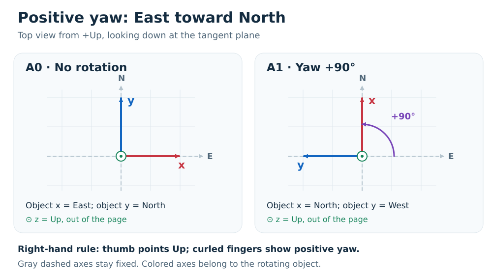
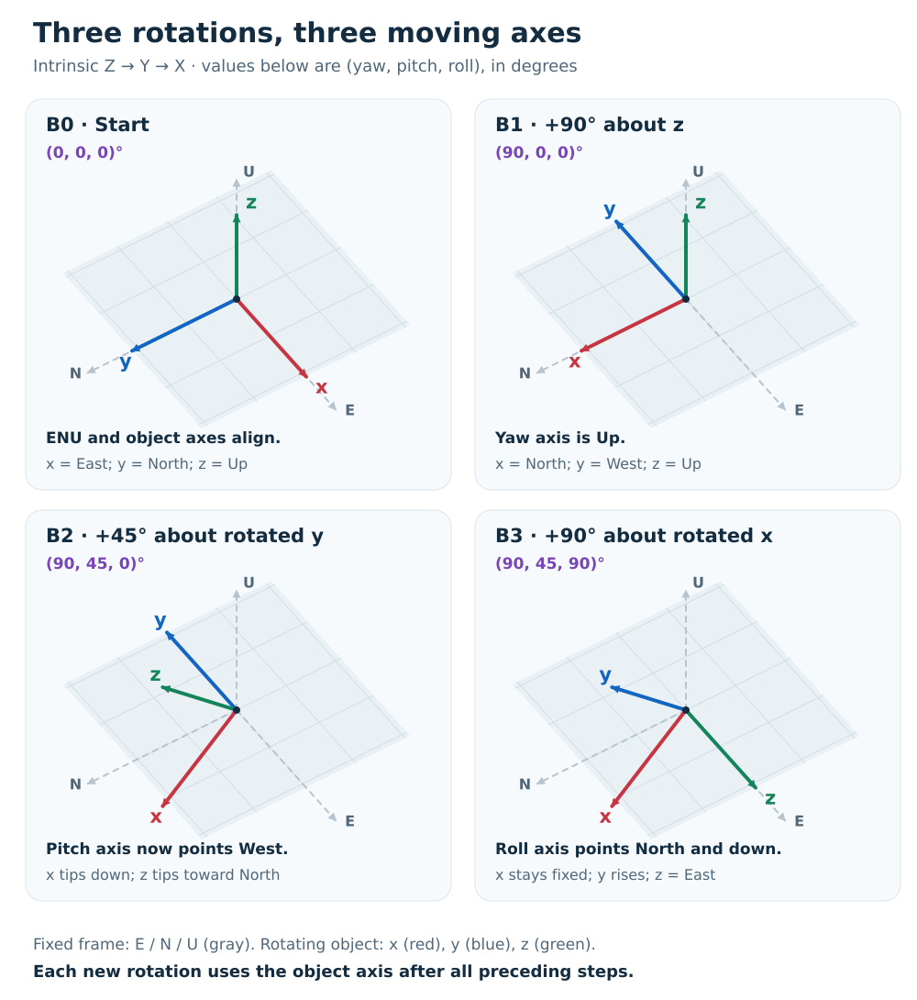
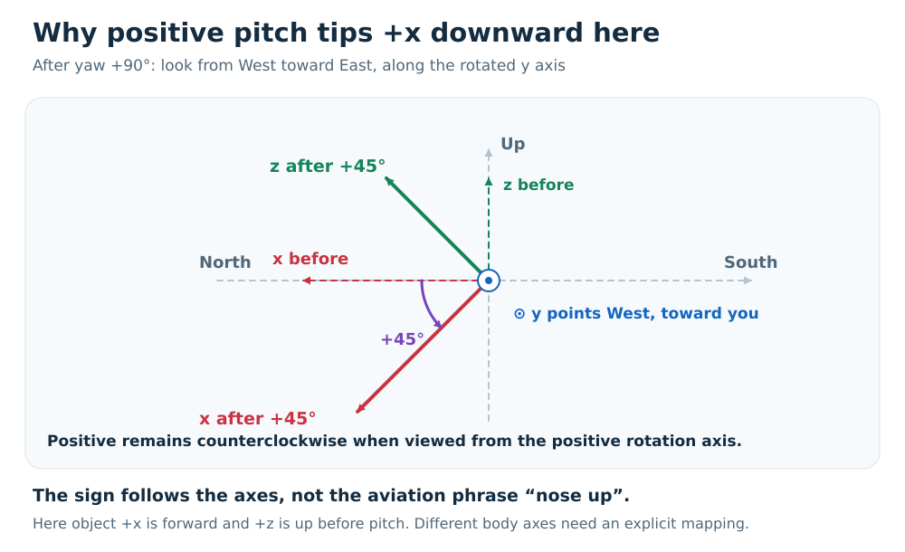

# Understanding GeoPose rotations relative to East–North–Up: yaw, pitch, roll and quaternions

GeoPose rotation are **right-handed**. Positive yaw turns **East toward North**, counterclockwise when viewed from **+Up looking down at the origin**. This guide makes that convention concrete
with three SVG illustrations, two reproducible pose sequences, and equivalent
GeoPose Basic YPR and Basic Quaternion examples.

- [How a quaternion stores an angle](#before-the-examples-how-a-quaternion-stores-an-angle)
- [Sequence A: zero rotation to +90° yaw](#sequence-a-zero-rotation-to-90-yaw)
- [Sequence B: yaw, then pitch, then roll](#sequence-b-yaw-then-pitch-then-roll)
- [Conversion mathematics](#conversion-mathematics)
- [Using the npm package](#using-the-npm-package)
- [Verification and reusable assets](#verification-and-reusable-assets)

## The convention used here

The fixed reference frame is the local WGS84 **East–North–Up (ENU)** frame:

| Reference axis | Direction |
| --- | --- |
| +X | East |
| +Y | North |
| +Z | Up, normal to the WGS84 ellipsoid |

The colored lowercase **x, y, z** axes in the illustrations belong to the object.
At zero rotation they coincide with ENU. In these examples, object **+x is
forward**. A camera or model with a different forward axis needs an explicit
body-axis mapping; yaw alone does not tell you where every model looks.

We use **right-handed intrinsic Z–Y–X rotations**, in this order:

1. **Yaw** about the initial +z (Up) axis.
2. **Pitch** about the object's +y axis **after yaw**.
3. **Roll** about the object's +x axis **after yaw and pitch**.

Point your right thumb along the positive rotation axis. Your curled fingers
show the positive direction. Equivalently, positive looks counterclockwise
when you look **from the positive end of that axis toward the origin**.
Looking from the other side reverses its apparent direction.

The quaternion is a unit Hamilton quaternion that maps **object coordinates to
ENU coordinates**. Named JSON properties are `x`, `y`, `z` and `w`; `w` is the
scalar part. JSON property order has no mathematical significance.

**Standard versus implementation.** OGC GeoPose 1.0 Requirement 13 specifies
the ENU axes, local/rotated Z–Y–X order, and degrees. Its wording does not
explicitly state the positive-angle rule. This guide documents the conventional
right-handed interpretation implemented by this repository's core
`yprToQuaternion()` and `quaternionToYPR()` functions. It does not claim that
the standard states that sign rule verbatim. See the [references](#references).

All examples use the same illustrative WGS84 position:
latitude **60°**, longitude **10°**, height **100 m above the ellipsoid**.
Only orientation changes. These are **local ENU quaternions**, not ECEF
quaternions. An ECEF pose needs the position-dependent ECEF-to-ENU rotation
before using the examples or formulas below.

## Before the examples: how a quaternion stores an angle

A rotation has a **physical angle** $\alpha$ and a **unit axis**
$\hat{\mathbf{a}}=(a_x,a_y,a_z)$ pointing along its positive rotation axis.
Its unit quaternion, written in xyzw order, is:

```math
(x,y,z,w)=
\left(
a_x\sin(\alpha/2),\;
a_y\sin(\alpha/2),\;
a_z\sin(\alpha/2),\;
\cos(\alpha/2)
\right).
```

The axis determines the direction of the quaternion's vector part $(x,y,z)$.
The sine and cosine use **half the physical rotation angle**. This is how
quaternions encode a rotation; it does not halve the object's rotation.

For pure yaw, the axis is +Up, so $\hat{\mathbf{a}}=(0,0,1)$ and
$\alpha=\psi$ (yaw). The formula simplifies to:

```math
(x,y,z,w)=\left(0,0,\sin(\psi/2),\cos(\psi/2)\right).
```

| Physical yaw $\psi$ | Half-angle $\psi/2$ used in the quaternion | $z$ | $w$ |
| --- | --- | --- | --- |
| 0° | 0° | $\sin(0^\circ)=0$ | $\cos(0^\circ)=1$ |
| +90° | +45° | $\sin(45^\circ)=1/\sqrt{2}$ | $\cos(45^\circ)=1/\sqrt{2}$ |

**The second row describes a 90° turn, not a 45° turn.** One way to see why
the half-angle works is to apply this yaw quaternion to the object's +x axis.
Its resulting ENU coordinates are:

```math
(1-2z^2,\;2wz,\;0)
=
\left(
1-2\sin^2(\psi/2),\;
2\sin(\psi/2)\cos(\psi/2),\;
0
\right)
=
(\cos\psi,\;\sin\psi,\;0).
```

The double-angle identities recover the full physical yaw $\psi$.
At +90° this vector is $(0,1,0)$: North.

Angles are shown in degrees here for readability. JavaScript's sine and
cosine functions take radians: +90° is $\pi/2$, and its half-angle is $\pi/4$.
The [conversion mathematics](#conversion-mathematics) section extends this
single-axis rule to combined yaw, pitch and roll.

## Sequence A: zero rotation to +90° yaw



The purple arrow shows counterclockwise yaw from above. The dot inside a circle
means the positive z axis points **out of the page**, toward you.

| Pose | Yaw | Pitch | Roll | Object +x | Object +y | Object +z |
| --- | ---: | ---: | ---: | --- | --- | --- |
| A0 — before | 0° | 0° | 0° | East | North | Up |
| A1 — after | +90° | 0° | 0° | North | West | Up |

### A0: identity / no rotation

**Basic YPR**

```json
{
  "position": {
    "lat": 60,
    "lon": 10,
    "h": 100
  },
  "angles": {
    "yaw": 0,
    "pitch": 0,
    "roll": 0
  }
}
```

**Basic Quaternion**

```json
{
  "position": {
    "lat": 60,
    "lon": 10,
    "h": 100
  },
  "quaternion": {
    "x": 0,
    "y": 0,
    "z": 0,
    "w": 1
  }
}
```

The identity quaternion is `(x, y, z, w) = (0, 0, 0, 1)`.
It leaves all three axes unchanged.

### A1: +90° yaw

**Basic YPR**

```json
{
  "position": {
    "lat": 60,
    "lon": 10,
    "h": 100
  },
  "angles": {
    "yaw": 90,
    "pitch": 0,
    "roll": 0
  }
}
```

**Basic Quaternion**

```json
{
  "position": {
    "lat": 60,
    "lon": 10,
    "h": 100
  },
  "quaternion": {
    "x": 0,
    "y": 0,
    "z": 0.7071067811865476,
    "w": 0.7071067811865476
  }
}
```

For this **+90° yaw**, the half-angle rule above gives
`z = sin(90° / 2) = sin(45°)` and `w = cos(90° / 2) = cos(45°)`.
Both components are positive; the object rotates the full **90°**.
The physical check is:

$$
(1,0,0)_{\mathrm{object}} \mapsto (0,1,0)_{\mathrm{ENU}}.
$$

That is **East to North**, not North to East.

## Sequence B: yaw, then pitch, then roll

This sequence starts again from identity. Its first two poses, **B0 and B1**,
are identical to **A0 and A1** above. It then adds +45° pitch and +90° roll.
The [JSON fixture file](examples/enu-rotation-poses.json) includes all four
poses in both GeoPose forms, including those repeated starting poses.



| Pose | Operation from previous pose | Absolute (yaw, pitch, roll) |
| --- | --- | --- |
| B0 | Start with object axes aligned to ENU | (0°, 0°, 0°) |
| B1 | +90° about object z, which is Up | (90°, 0°, 0°) |
| B2 | +45° about rotated object y, now pointing **West** | (90°, 45°, 0°) |
| B3 | +90° about rotated object x, now pointing **North and down** | (90°, 45°, 90°) |

The listed YPR values describe the **whole orientation at each stage**.
The pitch step does not rotate about fixed North; its axis has already moved
to West. The roll step does not rotate about fixed East.

### B2: add +45° pitch about the rotated y axis



With the chosen +x-forward body axes, **positive pitch tips forward downward**.
That follows the right-hand rule about +y; a “positive means nose up”
description from another axis convention cannot be copied into this one.
After the +90° yaw, the rotated +y points West, so the side view is taken from
West looking East. North appears on the left in this view.

**Basic YPR**

```json
{
  "position": {
    "lat": 60,
    "lon": 10,
    "h": 100
  },
  "angles": {
    "yaw": 90,
    "pitch": 45,
    "roll": 0
  }
}
```

**Basic Quaternion**

```json
{
  "position": {
    "lat": 60,
    "lon": 10,
    "h": 100
  },
  "quaternion": {
    "x": -0.2705980500730985,
    "y": 0.2705980500730985,
    "z": 0.6532814824381883,
    "w": 0.6532814824381883
  }
}
```

### B3: add +90° roll about the rotated x axis

The x axis stays fixed during this step. The y axis rotates toward the previous
z axis, and the z axis rotates toward the negative previous y axis.

**Basic YPR**

```json
{
  "position": {
    "lat": 60,
    "lon": 10,
    "h": 100
  },
  "angles": {
    "yaw": 90,
    "pitch": 45,
    "roll": 90
  }
}
```

**Basic Quaternion**

```json
{
  "position": {
    "lat": 60,
    "lon": 10,
    "h": 100
  },
  "quaternion": {
    "x": 0.2705980500730985,
    "y": 0.6532814824381883,
    "z": 0.2705980500730985,
    "w": 0.6532814824381883
  }
}
```

For exact quaternion checks, define
$a=\sin(22.5^\circ)/\sqrt{2}$ and $b=\cos(22.5^\circ)/\sqrt{2}$.
In xyzw order, B2 is $(-a,a,b,b)$ and B3 is $(a,b,a,b)$.
These produce the decimal components printed above.

Here is an independent geometric way to check the complete sequence.
Let $s = 1/\sqrt{2} \approx 0.7071067811865476$. Each tuple below is an
**(East, North, Up)** unit vector:

| Pose | Object x expressed in ENU | Object y expressed in ENU | Object z expressed in ENU |
| --- | --- | --- | --- |
| B0 | (1, 0, 0) | (0, 1, 0) | (0, 0, 1) |
| B1 | (0, 1, 0) | (−1, 0, 0) | (0, 0, 1) |
| B2 | (0, s, −s) | (−1, 0, 0) | (0, s, s) |
| B3 | (0, s, −s) | (0, s, s) | (1, 0, 0) |

In particular, B3's x points North/down at 45°, y points North/up at 45°,
and z points exactly East. These axes remain orthonormal and right-handed:
$x \times y = z$.

## Conversion mathematics

### What the rotation operates on

Use column vectors and define:

$$
v_{\mathrm{ENU}} = R\,v_{\mathrm{object}},
\qquad
R = R_z(\psi)\,R_y(\theta)\,R_x(\phi),
$$

where $\psi$ is yaw, $\theta$ is pitch, and $\phi$ is roll.
Each elementary matrix is a right-handed positive rotation:

$$
R_x(\phi)=
\begin{bmatrix}
1&0&0\\
0&\cos\phi&-\sin\phi\\
0&\sin\phi&\cos\phi
\end{bmatrix},
\quad
R_y(\theta)=
\begin{bmatrix}
\cos\theta&0&\sin\theta\\
0&1&0\\
-\sin\theta&0&\cos\theta
\end{bmatrix},
$$

$$
R_z(\psi)=
\begin{bmatrix}
\cos\psi&-\sin\psi&0\\
\sin\psi&\cos\psi&0\\
0&0&1
\end{bmatrix}.
$$

The columns of $R$ are the object's x, y, z axes expressed in ENU.
Intrinsic yaw–pitch–roll produces this product by successively rotating the
object's moving axes. If instead you interpret the product as successive
operations on a vector about **fixed** axes, the rightmost operation acts
first: X, then Y, then Z. These are two descriptions of the same final matrix.

For the reverse coordinate mapping use $R^\mathsf{T}$:
$v_{\mathrm{object}}=R^\mathsf{T}v_{\mathrm{ENU}}$.
Do not confuse this passive change of coordinates with turning the object.

### YPR to quaternion

GeoPose Basic YPR stores **degrees**. First convert each angle to radians:

$$
\alpha_{\mathrm{rad}}=\alpha_{\mathrm{deg}}\frac{\pi}{180}.
$$

Define the half-angle terms:

$$
c_\psi=\cos(\psi/2),\quad s_\psi=\sin(\psi/2),\qquad
c_\theta=\cos(\theta/2),\quad s_\theta=\sin(\theta/2),\qquad
c_\phi=\cos(\phi/2),\quad s_\phi=\sin(\phi/2).
$$

Then the quaternion components are:

$$
\begin{aligned}
x &= s_\phi c_\theta c_\psi-c_\phi s_\theta s_\psi,\\
y &= c_\phi s_\theta c_\psi+s_\phi c_\theta s_\psi,\\
z &= c_\phi c_\theta s_\psi-s_\phi s_\theta c_\psi,\\
w &= c_\phi c_\theta c_\psi+s_\phi s_\theta s_\psi.
\end{aligned}
$$

These are the formulas in
[the core conversion implementation](../packages/geopose-lib/src/core/conversions.ts).
For yaw only they reduce to
$q=(0,0,\sin(\psi/2),\cos(\psi/2))$ in **xyzw** notation.

### Composing rotations directly

Write a quaternion as $(\mathbf{u},w)$, with vector part
$\mathbf{u}=(x,y,z)$ and scalar part $w$. Hamilton multiplication is:

$$
(\mathbf{u}_a,w_a)\otimes(\mathbf{u}_b,w_b)
=
\left(
w_a\mathbf{u}_b+w_b\mathbf{u}_a+\mathbf{u}_a\times\mathbf{u}_b,\;
w_aw_b-\mathbf{u}_a\cdot\mathbf{u}_b
\right).
$$

For a unit axis $\hat{\mathbf{a}}$ and angle $\alpha$ in radians:

$$
q_{\hat{\mathbf{a}}}(\alpha)
=\left(\hat{\mathbf{a}}\sin(\alpha/2),\cos(\alpha/2)\right).
$$

Thus $q=q_z(\psi)\otimes q_y(\theta)\otimes q_x(\phi)$.
For the step-by-step sequence, angles below are written in degrees for clarity:

$$
\begin{aligned}
q_{B0}&=(0,0,0,1),\\
q_{B1}&=q_{B0}\otimes q_z(90^\circ),\\
q_{B2}&=q_{B1}\otimes q_y(45^\circ),\\
q_{B3}&=q_{B2}\otimes q_x(90^\circ).
\end{aligned}
$$

**Right-multiplication** applies an increment about the object's current axes.
**Left-multiplication** applies an increment expressed about the fixed ENU
axes. Multiplication is not commutative: swapping the factors usually changes
the physical result. Adding arbitrary Euler components is not a general
substitute for composing rotations.

A vector can also be rotated without a matrix. Embed it as the pure quaternion
$v_q=(v_x,v_y,v_z,0)$, then use $q\otimes v_q\otimes q^*$.
For a unit quaternion, $q^*=(-x,-y,-z,w)=q^{-1}$.

### Quaternion to YPR

First ensure that the quaternion is finite, nonzero, and unit length.
If needed, divide all four components by
$\sqrt{x^2+y^2+z^2+w^2}$. For this convention:

$$
\begin{aligned}
\phi &= \mathrm{atan2}\!\left(2(wx+yz),\,1-2(x^2+y^2)\right),\\
\theta &= \arcsin\!\left(\mathrm{clamp}\!\left(2(wy-zx),-1,1\right)\right),\\
\psi &= \mathrm{atan2}\!\left(2(wz+xy),\,1-2(y^2+z^2)\right).
\end{aligned}
$$

Convert each result from radians to degrees by multiplying by $180/\pi$.
In `atan2(a, b)`, `a` is the sine-like numerator and `b` the cosine-like
denominator; ordinary `atan(a / b)` loses quadrant information.

The usual result ranges are pitch in [−90°, +90°], and yaw/roll in
[−180°, +180°]. At pitch ±90°, yaw and roll are coupled (**gimbal lock**);
there is no unique pair to recover. A production conversion must choose and
document a singularity policy. This guide's mixed-angle example uses 45°
pitch to avoid that ambiguity.

Quaternions $q$ and $-q$ describe the same orientation. Euler triples can also
have equivalent representations. For general tests, compare rotation matrices
or normalized quaternions up to sign, not raw Euler strings. The decimal JSON
values here are rounded floating-point approximations; do not demand exact
decimal equality or exact unit length.

## Using the npm package

The examples below were checked with the published **`geopose-lib@0.0.2`**.

```bash
npm install geopose-lib@0.0.2
```

### Convert between the two Basic representations

Save this as an ES module (`.mjs`), or use it in an ESM TypeScript project:

```js
import { yprToQuaternion, quaternionToYPR } from "geopose-lib";

const basicYPR = {
  position: { lat: 60, lon: 10, h: 100 },
  angles: { yaw: 90, pitch: 45, roll: 0 }
};

const basicQuaternion = yprToQuaternion(basicYPR);
console.log(JSON.stringify(basicQuaternion, null, 2)); // B2 above

const recovered = quaternionToYPR(basicQuaternion);
console.log(recovered.angles); // approximately { yaw: 90, pitch: 45, roll: 0 }
```

The functions preserve position. They do not convert between ECEF and ENU.
Provide an ENU-relative unit quaternion when calling `quaternionToYPR()`.

### Use the GeoPoseBasic convenience wrapper

```js
import { GeoPoseBasic } from "geopose-lib";

const position = { lat: 60, lon: 10, h: 100 };
const pose = GeoPoseBasic.fromYPR(position, 0, 0, 0);

const before = pose.toGeoPose();                 // A0 / B0
pose.setYPROrientation(90, 0, 0);
const afterYaw = pose.toGeoPose();               // A1 / B1
pose.setYPROrientation(90, 45, 0);
const afterPitch = pose.toGeoPose();             // B2
pose.setYPROrientation(90, 45, 90);
const afterRoll = pose.toGeoPose();              // B3

console.log(pose.toGeoPoseYPRJSON(true));
console.log(pose.toGeoPoseJSON(true));
```

`setYPROrientation()` sets an **absolute** YPR orientation and mutates the
wrapper. The successive values above match the specified intrinsic sequence.
The returned `toGeoPose()` values are snapshots.

### Compass and camera headings are different quantities

Mathematical ENU yaw is zero when object +x points East and positive toward
North. A conventional compass heading is zero at North and positive toward
East. For the same horizontal +x-forward direction:

$$
\mathrm{yaw}_{ENU}=90^\circ-\mathrm{heading}_{compass}\pmod{360^\circ}.
$$

This scalar relationship is **not a complete camera-pose conversion**: camera
forward/up axes and pitch/roll signs must also be mapped.

In the repository revision reviewed for this guide, some `GeoPoseBasic` and
type comments describe yaw using compass language, and `heading` is a direct
alias for `yaw`. The Cesium camera adapters also pass camera heading directly
to the YPR helpers. These are known inconsistencies with the convention shown
here. Use the core YPR/quaternion functions for these examples; do not treat
the alias or a successful camera round trip as proof of heading compatibility.
This documentation change does not repair those adapters.

## Verification and reusable assets

The [fixture file](examples/enu-rotation-poses.json) contains two complete sets:

- **A:** A0 and A1.
- **B:** B0, B1, B2 and B3.

Each entry has a `basicYPR` object, an equivalent `basicQuaternion` object,
and independently specified `axesInENU` directions for verification.
Each Basic object is a standalone GeoPose. The surrounding collection and
its test metadata are **not** themselves a standardized GeoPose encoding.

From the repository root, check the examples against the npm release:

```bash
npm install --no-save geopose-lib@0.0.2
node docs/examples/enu-rotations.mjs
```

The script checks quaternion equivalence, YPR recovery, physical axis
directions and the convenience wrapper for all six entries. A tolerance of
`1e-12` is used for these particular unit-scale examples.

To check the repository implementation, run the normal package tests:

```bash
cd packages/geopose-lib
npm install
npm test
npm run build
```

The [explainer tests](../packages/geopose-lib/test/enu-rotation-explainer.test.ts)
check the golden poses and verify that the eight printed JSON objects match
the fixture file.

The illustrations are editable, resolution-independent SVGs with accessible
titles and descriptions:

- [Positive yaw, top view](images/enu-rotations/01-positive-yaw.svg)
- [Intrinsic sequence, perspective views](images/enu-rotations/02-intrinsic-sequence.svg)
- [Positive pitch, side view](images/enu-rotations/03-positive-pitch.svg)

Regenerate them with Python 3; no third-party packages are needed:

```bash
python docs/examples/generate-enu-illustrations.py
```

The perspective axis endpoints are calculated from the same stated
$R_zR_yR_x$ geometry, rather than placed by eye. All illustrations retain the
fixed ENU frame while showing the object's changing orientation.

## References

- [OGC GeoPose 1.0, section 8.4.1, Requirement 13](https://docs.ogc.org/is/21-056r11/21-056r11.html):
  Basic YPR reference axes, moving-axis order and degrees.
- [OGC GeoPose 1.0, section 8.4.2, Requirement 15](https://docs.ogc.org/is/21-056r11/21-056r11.html):
  Basic Quaternion and its initial ENU frame. Its logical component sequence
  is wxyz; JSON uses named components. This guide uses xyzw when writing tuples.
- [Core conversion source](../packages/geopose-lib/src/core/conversions.ts)
  and [GeoPoseBasic wrapper](../packages/geopose-lib/src/GeoPoseBasic.ts).
- [Cesium Camera documentation](https://cesium.com/learn/cesiumjs/ref-doc/Camera.html):
  camera heading examples and camera-frame definitions.

Implementation review baseline:
[`7d20400`](https://github.com/OpenArCloud/GeoPoseWrappers/commit/7d20400c0a6a968f005834fe87738bac47d43872);
npm execution baseline: `geopose-lib@0.0.2`.
